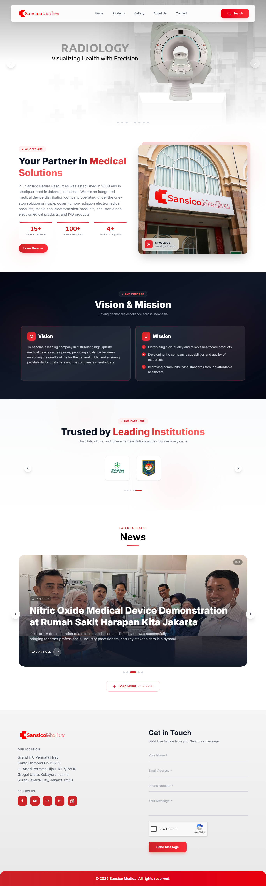
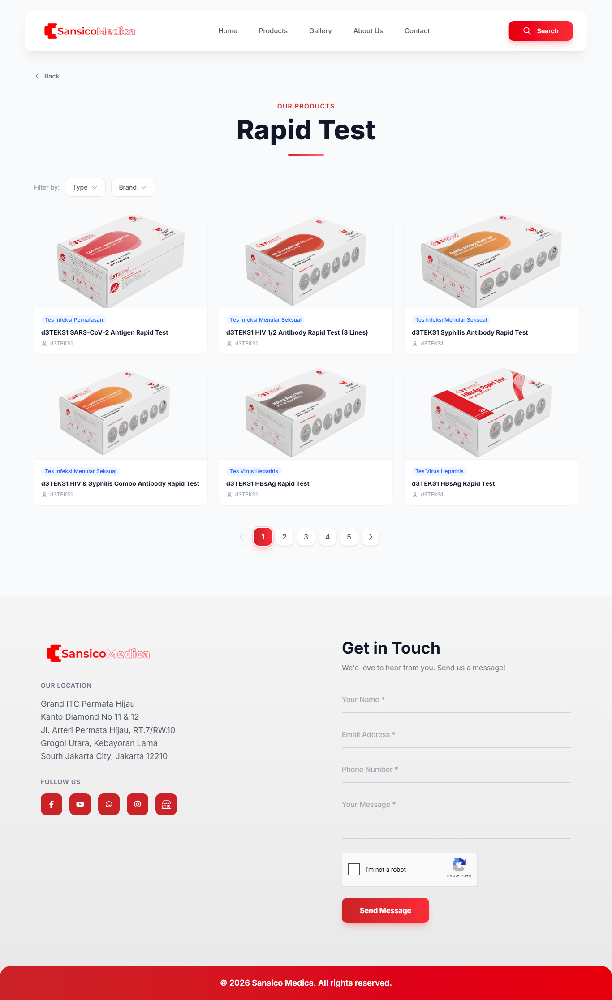
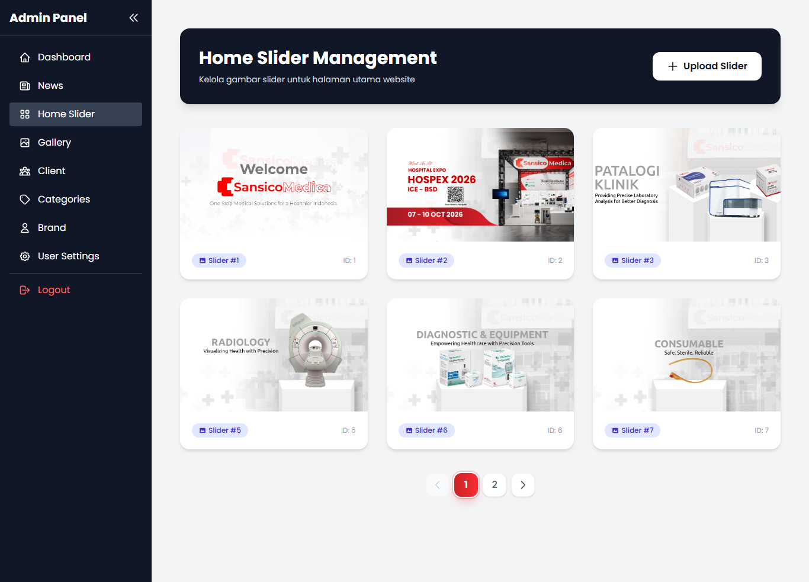

# Sansico Medica

Website company profile dan katalog produk untuk PT Sansico Natura Resources, distributor alat kesehatan di Jakarta, lengkap dengan panel admin untuk mengelola konten.

Situs: https://www.sansicomedica.com

Dikerjakan bersama [@sin666leton](https://github.com/sin666leton). Kode sumber private karena [milik klien / atas permintaan pemilik].

## Peran saya

- [Isi dengan bagian yang kamu kerjakan, misalnya: modul produk dan spesifikasi, pencarian produk, halaman publik, dll]

## Fitur

**Situs publik**
- Katalog produk bertingkat: kategori, sub kategori, jenis produk
- Detail produk beserta spesifikasi
- Pencarian produk berdasarkan nama
- Galeri, berita, daftar klien dan brand, banner slider di beranda
- Form kontak yang terkirim ke email perusahaan

**Panel admin**
- Login, logout, dan reset password lewat email
- CRUD untuk produk, kategori, sub kategori, jenis produk, brand, berita, galeri, logo klien, dan banner
- Template spesifikasi: admin menentukan format input spesifikasi per sub kategori, lalu dipakai saat menambah produk

**Di balik layar**
- Gambar yang diunggah otomatis dikonversi ke WebP lewat queue
- Pengiriman email (reset password, pesan dari form kontak) diproses di background
- Cache untuk mempercepat halaman yang sering dibuka

## Teknologi

- Backend: [Laravel / PHP, sesuaikan dengan composer.json]
- Frontend: [Blade, Tailwind, Bootstrap, dll]
- Database: [MySQL, dll]
- Queue: [database / Redis, dll]

## Tampilan

